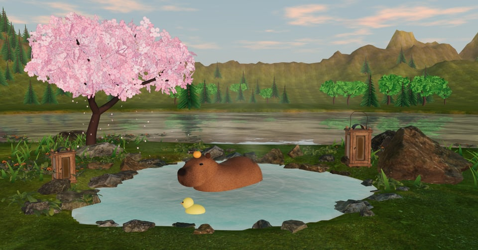
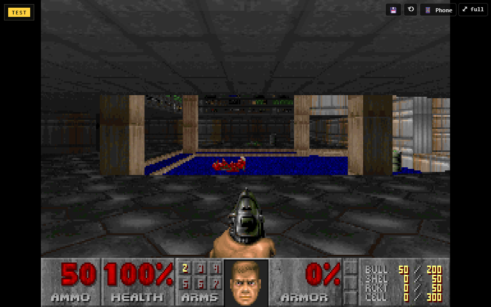

<h1 align="center">Hi, I'm NukeKevDev 🍊</h1>

  I build cozy little games that live <b>inside X posts</b>. Tap a post, play right in your feed.

  
  
  

---

### ♨️ Capybara Chill

A capybara soaks in a hot spring. Lofi plays, sakura petals drift down, a rubber duck paddles in circles. You keep it company, scratch it when it asks, and points drip in. No grind, just chill.

- The capybara is **sculpted in code**, no model file: signed distance fields → marching cubes → **shell fur** in a shader
- A sky that follows **your own clock**, or pick morning, day, evening or night yourself
- **Lofi radio generated live** with WebAudio, so the music belongs to nobody
- A see-through glass HUD, a leaderboard of capy friends, and 25% more points for Royal on **[Sojo](https://sojo.gg)**

▶ [Chill](https://capybara.sojo.gg) · 📦 [Source](https://github.com/anefril/capybara-chill) · 🐦 [Launch post](https://x.com/NukeKevDev/status/2115002602983457219)

---

### 🔫 DOOM in your X feed

The original **DOOM (1993)** running inside an X post as a player card. No download, no install.

- Chocolate Doom compiled to **WebAssembly**
- Hosted on **[Sojo](https://sojo.gg)**: sign in with X, gems, ads
- **Speedrun leaderboards** for every map of Episode 1, timed straight from the engine's memory, plus a Hall of Fame
- Phone controls with analog sticks, saves in the browser

▶ [Play](https://doom.sojo.gg) · 📦 [Source](https://github.com/anefril/doom-in-x) · 🐦 [Launch post](https://x.com/NukeKevDev/status/2114806567371673740)

 

---

### 🕹 X Card Games

DOOM and **Tyrian 2000**, playable inside X posts through player cards.

📦 [Source](https://github.com/anefril/x-card-games)

---

### 📝 TG Notes

Send anything to a Telegram bot (text, links, photos, voice, files) and it becomes a note on your own website: a list with pinning and drag-to-reorder, a sticky-note **wall** with arrows between notes, tags, search, reminders and auto-translation.

Next.js · Supabase · Tailwind · shadcn/ui · 📦 [Source](https://github.com/anefril/tg-notes)

---

### 🛠 Stack

♨️ thanks for stopping by. go scratch the capybara 🍊

